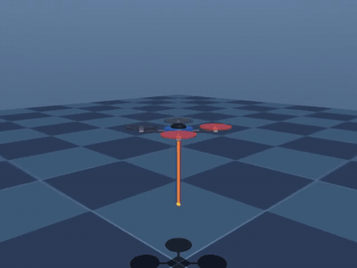
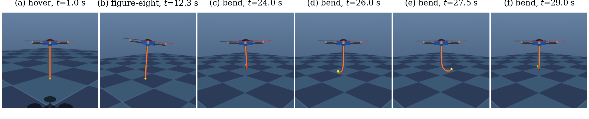

# Quadrotor + Soft Continuum Robot (MuJoCo)

An X-configuration quadrotor (1.06 kg) carrying a tendon-driven soft continuum arm (0.2 kg, 0.48 m backbone) mounted underneath it.

<p align="center">
  
  <br><em>Demo mission at 2× speed. Full-resolution video: <a href="media/demo.mp4">media/demo.mp4</a></em>
</p>


*(a) Hover with the arm hanging under gravity. (b) Figure-eight flight; inertial loads deflect the arm. (c)–(f) Hover while the tendons sweep the bending direction through a full revolution.*

| File | Contents |
|---|---|
| `quad_continuum.xml` | MJCF model: quad, 4 rotor thrust actuators, the 12-segment continuum arm, 3 tendons with tension actuators |
| `controller.py` | Geometric SE(3) tracking controller (position PID + SO(3) attitude), rotor mixer, tendon bending map |
| `demo.py` | Mission demo: interactive viewer, or headless mode that saves plots and video |
| `paper/make_figures.py` | Reproduces every figure and number in the accompanying paper |

## Model
- **Quadrotor**: each rotor is a `motor` on a site with gear `[0 0 1 0 0 ±0.016]` (thrust plus rotor drag torque). The controller builds its mixer from these gears.
- **Continuum robot**: a pseudo-rigid-body model. It has 12 capsule segments, each joined to the next by two orthogonal compliant hinges (stiffness 0.06 N·m/rad, damping 0.01). Together they approximate a rod that can bend in two directions.
- **Actuation**: three tendons are spaced 120° apart and routed through sites on every segment. Each tendon is pulled by a 0–6 N tension actuator. `bend_to_tensions(direction, magnitude)` converts a bending direction and magnitude into three tensions that stay within the limit and bend the arm equally in every direction.

Control vector: `ctrl[0:4]` = rotor thrusts [N], `ctrl[4:7]` = tendon tensions [N].

## Run
```bash
pip install -r requirements.txt
mjpython demo.py            # interactive viewer (on macOS you must use mjpython)
python demo.py --headless   # saves results/flight_log.png and results/demo.mp4
```
Viewer markers: green = reference trail, yellow = arm-tip trail. Ctrl + right-drag on a body applies a disturbance, and Backspace resets.

## Mission (36 s, loops in the viewer)
1. 0–3 s: hover at 1.0 m
2. 3–6 s: climb to 1.6 m
3. 6–22 s: fly a figure-eight while the arm swings passively
4. 22–32 s: hover while the tendons sweep the arm tip in a circle
5. 32–36 s: return to the start

## Reproducing the paper results
```bash
cd paper && python make_figures.py   # writes paper/figures/*.pdf and paper/results.json
```
The full set of experiments takes about a minute on a laptop CPU.

## Citation
If you use this code, please cite the accompanying paper, *An Open MuJoCo Simulation Framework for a Quadrotor Carrying a Tendon-Driven Soft Continuum Arm* (H. El-Hussieny, 2026). The arXiv reference will be added here once it is available.

## License
MIT, see [LICENSE](LICENSE).
